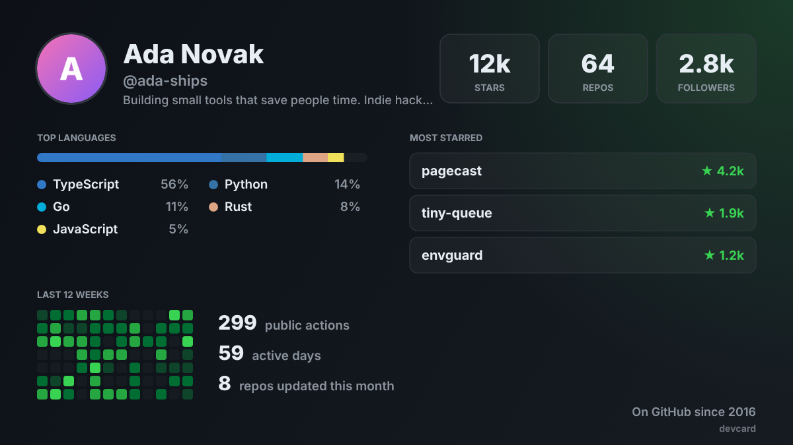

# DevCard

**Your GitHub, as a card worth sharing.**

Type a username. Get stars, top languages, most starred repos and 12 weeks of activity in one 1200×675 image that looks good on X and LinkedIn.

**[Try it live](https://lockdomain.github.io/devcard/)**



*The example above uses a sample profile.*

## Features

* Stars, repos and followers at a glance
* Top languages weighted by project size, not just repo count
* Your three most starred repos
* A 12 week activity grid from your public GitHub events
* Four themes, download as PNG, copy to clipboard, or share straight to X
* Shareable link: `lockdomain.github.io/devcard/#yourname`

## Privacy

DevCard calls the public GitHub REST API directly from your browser. No token, no server, nothing stored. Anonymous requests are limited by GitHub to 60 an hour per IP, which is plenty for a few cards.

## How the numbers are calculated

* **Stars and forks**: summed over your own repos, forks excluded
* **Languages**: each repo adds the square root of its size plus half its stars to its main language
* **Activity**: public events from the last 84 days. Pushes count by number of commits, other events count as one. GitHub keeps about 90 days of public events, so this is not the same number as your contribution graph

All of it lives in `stats.js`, which also runs in Node.

## Run locally

```
git clone https://github.com/lockdomain/devcard
cd devcard
python3 -m http.server
```

## License

MIT
